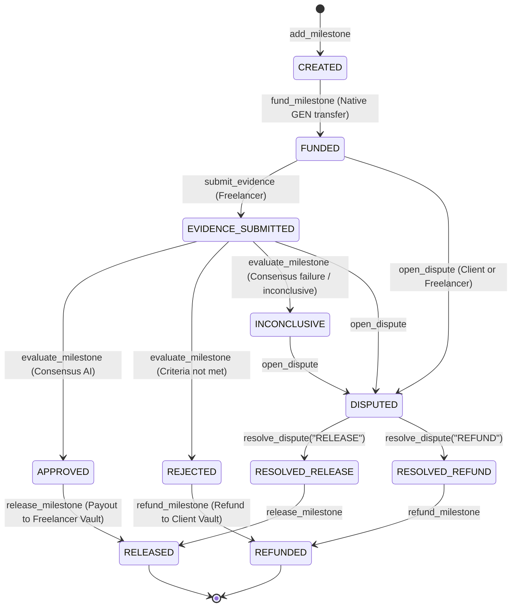

# TrustLedger — Native GEN Milestone Escrow on GenLayer StudioNet

**TrustLedger** is a decentralized, AI-adjudicated milestone escrow application built on GenLayer StudioNet (`chainId: 61999`). It enables clients and freelancers to agree on deliverables with verifiable acceptance criteria, fund milestones using native **GEN tokens**, evaluate submissions using multi-validator consensus AI, and settle payouts or refunds with cryptographic finality.

---

## Architecture Overview

```mermaid
flowchart TD
    Client["Client EOA"] -->|1. fund_milestone(mid) + Native GEN| Escrow["TrustLedgerEscrow Contract"]
    Escrow -->|Balance Verification| EscrowBal["Authoritative Escrow Balance"]
    Freelancer["Freelancer EOA"] -->|2. submit_evidence(url, hash)| Escrow
    Escrow -->|3. evaluate_milestone(mid)| Validators["GenLayer Multi-Validator AI Consensus"]
    Validators -->|gl.vm.run_nondet_unsafe| Verdict["Verdict: APPROVED / REJECTED / INCONCLUSIVE"]
    Verdict --> Escrow
    
    subgraph Settlement Flow
        Escrow -->|4a. release_milestone (APPROVED / Dispute RELEASE)| FVault["Freelancer Vault Contract"]
        Escrow -->|4b. refund_milestone (REJECTED / Dispute REFUND)| CVault["Client Refund Vault Contract"]
    end

    FVault -->|Triggered Child Tx| FBal["Freelancer Credited"]
    CVault -->|Triggered Child Tx| CBal["Client Credited"]
```

---

## Key Features

1. **Native GEN Payments**:
   - Milestones are funded directly on-chain using `@gl.public.write.payable` and `gl.message.value`.
   - Partial funding and overfunding are strictly rejected.
   - Balances are verified against authoritative on-chain state (`self.balance`, `eth_getBalance`).
2. **Multi-Validator AI Adjudication**:
   - Freelancer deliverables are submitted with cryptographic SHA-256 hashes and URLs.
   - GenLayer multi-validator consensus fetches the deliverable and evaluates each acceptance criterion against defined weights and mandatory flags.
   - Non-deterministic agreement ensures multi-model validator equivalence.
3. **Inconclusive Evaluation & Explicit Dispute Path**:
   - If evaluation is `INCONCLUSIVE`, funds are **never silently transferred**.
   - An explicit dispute path (`open_dispute`) allows mutual resolution or binding arbitrator intervention (`resolve_dispute`).
4. **Automated On-Chain Settlement**:
   - Payouts and refunds use GenVM's native transfer mechanism: `gl.get_contract_at(recipient).emit_transfer(value=..., on="finalized")`.
   - StudioNet automatically dispatches a child transaction of `type: 2` crediting recipient smart vaults (`TrustLedgerVault`).
5. **Rigorous Security Invariants**:
   - **Cross-user isolation**: Clients cannot withdraw other clients' funds.
   - **Checks-Effects-Interactions (CEI)**: State variables are updated prior to emitting transfer messages.
   - **Double-settlement prevention**: Guarded against replay attacks and duplicate payouts.
   - **Immutable terms**: Milestone amounts and recipients are immutable after funding unless agreed upon via mutual amendment (`propose_recipient_amendment` + `approve_recipient_amendment`).

---

## State Transition Diagram



---

## Live StudioNet Deployed Contracts

Verified on StudioNet (`chainId: 61999`, RPC: `https://studio.genlayer.com/api`):

| Contract | Address | Purpose |
| :--- | :--- | :--- |
| **TrustLedgerEscrow** | [`0x02b52a875Aad5aE41b3997725364C00C715A99C4`](file:///C:/Users/NO%20GO%20NO/trustLedger/contracts/trust_ledger.py) | Main milestone escrow contract |
| **FreelancerVault** | [`0x02c7c74e61ccf3DD594ab80D4A1Da40101E44775`](file:///C:/Users/NO%20GO%20NO/trustLedger/contracts/recipient_vault.py) | Smart vault for freelancer native GEN payouts |
| **ClientRefundVault** | [`0x7E5Eb0458bF08DcfF50f619853e4A071aDBd0068`](file:///C:/Users/NO%20GO%20NO/trustLedger/contracts/recipient_vault.py) | Smart vault for client native GEN refunds |

Detailed transaction hashes and verified balance deltas are available in [`ACCEPTANCE_REPORT.md`](file:///C:/Users/NO%20GO%20NO/trustLedger/ACCEPTANCE_REPORT.md).

---

## Running the Acceptance Test

Execute the full end-to-end StudioNet acceptance test:

```powershell
node scripts/acceptance_test_studionet.mjs
```

The script performs:
1. Generation and funding of Client, Freelancer, and Arbitrator test accounts.
2. Deployment of `FreelancerVault`, `ClientRefundVault`, and `TrustLedgerEscrow`.
3. Project creation and addition of two milestones with weighted criteria.
4. Real payable funding of Milestone 1 (`150,000 wei GEN`).
5. Evidence submission and multi-validator AI consensus evaluation.
6. Authorized arbitration and release payout to `FreelancerVault` (+150,000 wei).
7. Real payable funding of Milestone 2 (`200,000 wei GEN`).
8. Dispute opening, concession resolution, and refund payout to `ClientRefundVault` (+200,000 wei).
9. Full balance verification and generation of `artifacts/acceptance_report.json`.

---

## Running Direct Tests

Fast offline unit tests can be run using the GenVM direct execution harness:

```powershell
$env:GENVM_VERSION="v0.6.0-rc9"
pytest tests/direct/ -v
```

All 6 direct test scenarios cover:
- Happy path funding, evaluation, and release.
- Partial funding, overfunding, and zero funding rejection.
- Unauthorized calls and cross-user isolation.
- Immutability post-funding and mutual amendment rules.
- Duplicate settlements, replayed decisions, and insufficient balance guards.
- Inconclusive evaluation handling, dispute opening, and refund flows.

---

## Frontend Application

A responsive Next.js 16 dashboard provides live on-chain metrics, project overviews, milestone status badges, and action modals for funding, evidence submission, and dispute resolution.

### Running the Frontend

```powershell
cd frontend
npm run dev
```

Open [http://localhost:3000](http://localhost:3000) in your browser.

> [!WARNING]
> **Currency Notice**: StudioNet GEN tokens are testnet currency with no monetary value.
