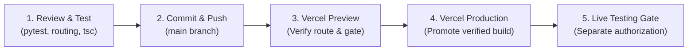

# TrustLedger — Native GEN Milestone Escrow on GenLayer StudioNet

[-blue)](https://studio.genlayer.com)
[](https://nextjs.org)
[](https://www.typescriptlang.org)
[](https://docs.genlayer.com)
[](tests/direct/)
[](frontend/tests/address_routing.test.mjs)
[](https://trustledger-nine.vercel.app)

> **Elevator Pitch:** TrustLedger is an autonomous, milestone-based agreement and escrow platform built on [GenLayer StudioNet](https://studio.genlayer.com). It enables clients and service providers to lock native GEN funds into cryptographically secure escrow, evaluate off-chain deliverables using multi-validator AI consensus against weighted acceptance criteria, and execute audited pull-claim disbursements to recipient smart vaults.

---

## Table of Contents

1. [Project Overview](#1-project-overview)
2. [Visual Presentation & UI Capture](#2-visual-presentation--ui-capture)
3. [How TrustLedger Works](#3-how-trustledger-works)
4. [GenLayer Architecture & Consensus](#4-genlayer-architecture--consensus)
5. [Critical Transfer Limitation](#5-critical-transfer-limitation)
6. [Contract Versions & Deployed Addresses](#6-contract-versions--deployed-addresses)
7. [Repository Structure](#7-repository-structure)
8. [Technology Stack & Prerequisites](#8-technology-stack--prerequisites)
9. [Local Setup & Verification](#9-local-setup--verification)
10. [Environment Configuration](#10-environment-configuration)
11. [Testing & Verification Evidence](#11-testing--verification-evidence)
12. [Security Model & Threat Boundaries](#12-security-model--threat-boundaries)
13. [Deployment Guide](#13-deployment-guide)
14. [Roadmap & Contribution Guide](#14-roadmap--contribution-guide)

---

## 1. Project Overview

### The Real-World Problem
Traditional freelance and contract agreements suffer from two symmetric risks:
1. **Freelancer Risk (Payment Uncertainty):** Service providers complete deliverables without guaranteed payment, risking client default, arbitrary payment withholding, or protracted payment terms.
2. **Client Risk (Deliverable Default):** Clients deposit funds upfront into conventional custodial escrow systems, where dispute resolution is opaque, slow, and dependent on biased or expensive human intermediaries.

Conventional project trackers (e.g., Trello, Jira) track task progress but have zero custody over funds. Basic blockchain escrow smart contracts hold funds deterministically, but cannot interpret real-world deliverables, web endpoints, code commits, or complex qualitative acceptance criteria without centralized oracles.

### The TrustLedger Solution
TrustLedger addresses this divide using GenLayer's Intelligent Contract runtime:
- **Milestone Agreements Reduce Ambiguity:** Agreements are decomposed into discrete milestones with structured JSON acceptance criteria containing explicit weights (summing to 100%) and mandatory flags.
- **Evidence-Driven AI Consensus:** When a freelancer submits deliverable evidence (a URL and a SHA-256 commitment hash), multi-validator AI consensus autonomously fetches the artifact via non-deterministic web access (`gl.nondet.web.get`), assesses compliance against each agreed criterion via non-deterministic LLM prompting (`gl.nondet.exec_prompt`), and achieves multi-node agreement (`gl.vm.run_nondet_unsafe`).
- **Cryptographic Solvency & Pull Escrow:** Funds are deposited in native **GEN** tokens directly into the contract. State transitions strictly enforce the Checks-Effects-Interactions (CEI) pattern and a pull-claim architecture, ensuring funds remain mathematically solvent.
- **Explicit Dispute & Concession Paths:** If AI evaluation is `INCONCLUSIVE` (e.g., network failure, unparseable response, or missing criteria), funds are **never silently transferred**. Either party can open a dispute for designated arbitrator intervention or mutual concession.

### Capabilities Matrix

| Capability | Current Status (Verified) | Planned / Future Work |
| :--- | :--- | :--- |
| **Native GEN Escrow Funding** | Implemented (`fund_milestone` payable) | Multi-token ERC-20 wrapper support |
| **Structured Milestone Criteria** | Implemented (weighted JSON, mandatory flags) | Dynamic on-chain criteria templates |
| **Multi-Validator AI Evaluation** | Implemented (`_evaluate_evidence_nondet`) | Multi-modal evaluation (image/audio artifacts) |
| **Arbitration & Mutual Concession**| Implemented (`open_dispute`, `resolve_dispute`) | Multi-sig arbitration panels |
| **Pull-Claim Disbursement** | Implemented (`withdraw_claim`) | Batch claim withdrawals across projects |
| **Deployer Vault Whitelist** | Implemented (`register_approved_vault`) | On-chain factory bytecode verification |
| **Asynchronous Transfer Quarantine**| Implemented (`total_escrow_dispatched_wei`) | Protocol-level child-transfer receipts |
| **Historical Run 2 Preservation** | Implemented (Project #1 pinned) | Cross-version migration utility |
| **V2 StudioNet Contract** | Deployed (`0x4Ec4...`, 0 vaults approved) | Live micro-test funding & settlement |

---

## 2. Visual Presentation & UI Capture

The TrustLedger frontend is a responsive Next.js application designed for real-time monitoring of on-chain escrow states, milestone progress, consensus rationales, and claim statuses.

### Capturing UI Screenshots
No synthetic or mock screenshots are bundled in this repository to prevent misleading representations. Developers and evaluators can capture live screenshots directly:

1. **Via Live Production Deployment:**
   - Navigate to the verified canonical production deployment: [https://trustledger-nine.vercel.app](https://trustledger-nine.vercel.app)
   - Alternatively, access the verified preview deployment: [https://trustledger-k2ud12pju-jamism123.vercel.app](https://trustledger-k2ud12pju-jamism123.vercel.app)

2. **Via Local Development Server:**
   ```powershell
   cd frontend
   npm run dev
   ```
   Open [http://localhost:3000](http://localhost:3000) in your browser.

3. **Key Views to Capture:**
   - **Historical Run 2 Project View:** Displays Project #1 (`Decentralized Autonomous Escrow Protocol`), showing funded milestones, consensus scores, and historical accounting.
   - **Milestone Evaluation Modal:** Inspect the breakdown of weighted acceptance criteria, mandatory flags, and validator rationales.
   - **V2 Pre-Deployment Gate:** Demonstrates the fail-closed UI state blocking new project creation while `NEXT_PUBLIC_V2_DEPLOYED=false`.
   - **Claim & Dispatch Status Panel:** Shows pull-claim status badges (`CLAIMABLE`, `DISPATCHED`) with explicit transfer notices.

---

## 3. How TrustLedger Works

TrustLedger enforces an audited, deterministic lifecycle for milestone funding, adjudication, settlement, and fund withdrawal.

```mermaid
flowchart TD
    Client["Client EOA"] -->|1. create_project()| Escrow["TrustLedgerEscrow Contract"]
    Client -->|2. add_milestone(weights, criteria)| Escrow
    Client -->|3. fund_milestone() + Native GEN| Escrow
    
    Freelancer["Freelancer EOA"] -->|4. submit_evidence(url, sha256)| Escrow
    
    subgraph Adjudication ["AI Consensus Adjudication"]
        Escrow -->|5. evaluate_milestone()| Validators["GenLayer Multi-Validator Consensus"]
        Validators -->|gl.nondet.web.get| Web["Deliverable Artifact"]
        Validators -->|gl.nondet.exec_prompt| LLM["Impartial Evaluation LLM"]
        Validators -->|gl.vm.run_nondet_unsafe| Verdict["Verdict Consensus"]
    end
    
    Verdict -->|APPROVED / score >= 70| Approved["Status: APPROVED"]
    Verdict -->|REJECTED / criteria unmet| Rejected["Status: REJECTED"]
    Verdict -->|INCONCLUSIVE / fetch error| Inconclusive["Status: INCONCLUSIVE"]
    
    subgraph Settlement ["Settlement & Pull-Claim Creation"]
        Approved -->|6a. release_milestone()| ClaimPayout["ClaimRecord (PAYOUT, CLAIMABLE)"]
        Rejected -->|6b. refund_milestone()| ClaimRefund["ClaimRecord (REFUND, CLAIMABLE)"]
        Inconclusive -->|Dispute Path| Disputed["Status: DISPUTED"]
        Disputed -->|resolve_dispute(RELEASE)| ClaimPayout
        Disputed -->|resolve_dispute(REFUND)| ClaimRefund
    end
    
    subgraph Withdrawal ["Asynchronous Vault Dispatch"]
        ClaimPayout -->|7. withdraw_claim(cid)| Dispatch["emit_transfer(on='finalized')"]
        ClaimRefund -->|7. withdraw_claim(cid)| Dispatch
        Dispatch -->|Asynchronous Message| Vault["TrustLedgerVault Contract"]
        Dispatch -->|Permanent Quarantine| Quarantined["Status: DISPATCHED (Liability Cleared)"]
    end
```

### End-to-End Operational Lifecycle

| Step | Operation | Responsible Module | Contract Method | Invariant / Security Rule |
| :--- | :--- | :--- | :--- | :--- |
| **1** | **Project Creation** | Frontend / EOA | `create_project(title, desc, refund_recipient, arbitrator)` | Initializes project record; registers client EOA as sole authority for milestone creation. |
| **2** | **Milestone Definition** | Frontend / EOA | `add_milestone(project_id, title, desc, criteria_json, freelancer, recipient, amount_wei)` | Validates that criteria JSON is well-formed, IDs are unique, and weights sum to exactly 100. Amount must be > 0. |
| **3** | **Milestone Funding** | Frontend / Client EOA | `fund_milestone(milestone_id)` (`@gl.public.write.payable`) | Enforces `gl.message.value == milestone.amount_wei`. Rejects underfunding and overfunding. Verifies on-chain contract solvency. |
| **4** | **Evidence Submission** | Frontend / Freelancer EOA | `submit_evidence(milestone_id, evidence_url, evidence_hash, submission_notes)` | Only designated freelancer can submit. Increments `submission_version` and invalidates any prior evaluations to prevent replay attacks. |
| **5** | **Consensus Evaluation** | Client / Freelancer / Arbitrator | `evaluate_milestone(milestone_id)` | Runs leader and validator functions using `gl.vm.run_nondet_unsafe`. Compares verdict, mandatory criteria, and score within `SCORE_TOLERANCE = 15`. |
| **6** | **Settlement Eligibility** | Authorized Participant | `release_milestone(mid)` or `refund_milestone(mid)` | Atomically converts locked milestone liability to `ClaimRecord` in `CLAIMABLE` status. Increments `settlement_count` to prevent duplicate claims. |
| **7** | **Claim Withdrawal** | Beneficiary or Recipient Vault | `withdraw_claim(claim_id)` | Verifies single-use status, checks vault in `approved_vaults`, moves liability to `total_escrow_dispatched_wei`, and emits asynchronous transfer. |

### Handling Specific Outcomes
- **Successful Completion (`APPROVED`):** When earned score $\ge 70$ and all mandatory criteria pass, status transitions to `APPROVED`. Calling `release_milestone` moves funds from `total_escrow_locked_wei` to `total_escrow_claimable_wei` and creates a `PAYOUT` claim.
- **Definitive Rejection (`REJECTED`):** When criteria fail or score $< 70$, status transitions to `REJECTED`. Calling `refund_milestone` moves funds to `total_escrow_claimable_wei` and creates a `REFUND` claim for the client's refund vault.
- **Inconclusive Outcomes (`INCONCLUSIVE`):** Triggered by network failures, HTTP non-200 responses, empty bodies, or contradictory evidence. **Funds are never released or refunded automatically**. Funds remain safely locked. The freelancer may remediate deliverables and re-submit evidence, or either party may call `open_dispute`.
- **Disputed Milestones (`DISPUTED`):** Can be opened from `FUNDED`, `EVIDENCE_SUBMITTED`, `APPROVED`, `REJECTED`, or `INCONCLUSIVE`. Resolvable only by:
  1. The designated arbitrator (can resolve as `RELEASE` or `REFUND`).
  2. The client conceding and authorizing `RELEASE`.
  3. The freelancer conceding and authorizing `REFUND`.
- **Uncertain / Asynchronous Outgoing Transfers:** Once `withdraw_claim` executes, the claim transitions to `DISPATCHED`. Because GenLayer does not provide parent execution receipts, the contract permanently quarantines the liability in `total_escrow_dispatched_wei`. Retries are strictly rejected.

---

## 4. GenLayer Architecture & Consensus

### Why TrustLedger Uses GenLayer
Conventional blockchains force contracts to choose between trustless execution (pure determinism, zero real-world data) or centralized trust (external oracles). GenLayer introduces **Intelligent Contracts** running on GenVM, where validator nodes execute non-deterministic actions (web requests, LLM inference) and reach consensus on semantic equivalence.

### StudioNet Network Parameters
- **Network Name:** GenLayer StudioNet
- **Chain ID:** `61999`
- **RPC Endpoint:** `https://studio.genlayer.com/api`
- **Native Denomination:** `GEN` ($1\text{ GEN} = 10^{18}\text{ wei}$)
- **Consensus Main Contract:** `0xb7278A61aa25c888815aFC32Ad3cC52fF24fE575`
- **Runner Hash:** `py-genlayer:1jb45aa8ynh2a9c9xn3b7qqh8sm5q93hwfp7jqmwsfhh8jpz09h6`

### Escrow and Recipient Vault Architecture
TrustLedger separates pooled custody from individual disbursements:
1. **`TrustLedgerEscrow`:** A centralized registry and escrow holding contract. It tracks all projects, milestones, claims, and accounting liabilities. It rejects raw native GEN transfers (`__receive__` raises `UserError`) and only accepts GEN via `fund_milestone`.
2. **`TrustLedgerVault`:** Dedicated smart vaults deployed per participant (`contracts/recipient_vault.py`). Recipient vaults receive asynchronous transfers from the escrow contract, record receipt history (`__receive__`), and allow the vault owner to withdraw funds (`transfer_out`).

```mermaid
flowchart LR
    subgraph StudioNet ["GenLayer StudioNet (Chain ID: 61999)"]
        subgraph FrontendApp ["Next.js Frontend Client"]
            UI["Web UI Dashboard"]
            Provider["genlayer-js / viem Provider"]
        end

        subgraph CoreEscrow ["TrustLedgerEscrow Contract"]
            DeployerAuth["Deployer Access Control"]
            LockedBucket["total_escrow_locked_wei"]
            ClaimableBucket["total_escrow_claimable_wei"]
            DispatchedBucket["total_escrow_dispatched_wei (Quarantine)"]
            ApprovedRegistry["approved_vaults Registry"]
        end

        subgraph RecipientVaults ["Authorized Recipient Vaults"]
            FVault["Freelancer Smart Vault (TrustLedgerVault)"]
            CVault["Client Refund Smart Vault (TrustLedgerVault)"]
        end
    end

    UI --> Provider
    Provider -->|eth_call (View State)| CoreEscrow
    Provider -->|Signed Transactions| CoreEscrow

    CoreEscrow -.->|Asynchronous Message Queue\nemit_transfer(on='finalized')| RecipientVaults
```

### Consensus & Non-Deterministic Agreement
The evaluation pipeline executes inside `evaluate_milestone`:
```python
def leader_fn() -> dict:
    return _evaluate_evidence_nondet(...)

def validator_fn(leaders_res: gl.vm.Result) -> bool:
    # Verifies verdict match, mandatory criteria match,
    # and score delta within SCORE_TOLERANCE (15 points)
    ...

decision = gl.vm.run_nondet_unsafe(leader_fn, validator_fn)
```
- **Leader Node:** Fetches the evidence URL and submits the deliverable to an impartial LLM auditor prompt.
- **Validator Nodes:** Independently execute the same fetch and prompt, comparing results against the leader's calldata. If the verdict matches, mandatory requirements align, and score differences do not exceed $\pm 15$ points, validators cast agreeing votes.

### Synchronous vs. Asynchronous Operations
- **Synchronous Operations:** All contract state transitions, criteria validations, project creation, funding validations, dispute updates, and claim creation occur within a single atomic transaction.
- **Asynchronous Operations:** Child value transfers dispatched via `gl.get_contract_at(vault).emit_transfer(value, on="finalized")` are placed into the validator consensus message queue. They execute asynchronously across blocks.

---

## 5. Critical Transfer Limitation

> [!WARNING]
> ### Crucial Operational Notice: Asynchronous Transfer Semantics
> In GenLayer, `emit_transfer(..., on="finalized")` dispatches an outgoing transfer asynchronously. The successful inclusion and finalization of the parent `withdraw_claim` transaction **does not prove that the recipient vault received or accepted the funds**.
>
> The GenVM runtime does not provide parent contracts with synchronous return values, cross-contract execution receipts, or child-transfer status callbacks.

### Architectural Consequences & Protections
1. **`DISPATCHED` is Not `PAID`:** The contract state machine marks a claim as `DISPATCHED`, not `PAID`. The frontend and documentation explicitly label these dispatches as dispatched messages rather than settled bank confirmations.
2. **Permanent Quarantine:** When a claim is dispatched, its wei amount is atomically deducted from `total_escrow_claimable_wei` and credited to `total_escrow_dispatched_wei`. If the child transfer fails in the network, the native GEN remains physically in the escrow balance, but the contract permanently quarantines this balance from active accounting.
3. **No Automatic Retries:** Retries (`retry_failed_withdrawal`) are deliberately disabled. Permitting retries on asynchronous transfers would expose the contract to double-spending if a delayed child transfer finalized after a retry was broadcast.
4. **Where to Inspect:** Developers can audit this exact containment implementation in [`contracts/trust_ledger.py` lines 1180–1256](contracts/trust_ledger.py#L1180-L1256) and [`tests/direct/test_final_async_architecture.py`](tests/direct/test_final_async_architecture.py).

---

## 6. Contract Versions & Deployed Addresses

TrustLedger maintains strict separation between its historical demonstration deployment and the hardened V2 contract.

### Historical Run 2 Deployment (Preserved)
The Run 2 deployment contains historical Project #1 (`Decentralized Autonomous Escrow Protocol`), executed on StudioNet:
- **Escrow Contract:** [`0x02b52a875Aad5aE41b3997725364C00C715A99C4`](contracts/trust_ledger.py)
- **Freelancer Recipient Vault:** [`0x02c7c74e61ccf3DD594ab80D4A1Da40101E44775`](contracts/recipient_vault.py)
- **Client Refund Vault:** [`0x7E5Eb0458bF08DcfF50f619853e4A071aDBd0068`](contracts/recipient_vault.py)
- **Routing Status:** Project #1 is permanently pinned to Run 2 in [`frontend/src/lib/genlayer.ts`](frontend/src/lib/genlayer.ts). Historical state and completed milestones are immutable and preserved.

### TrustLedger V2 Deployment (Current)
Deployed as an independent Intelligent Contract instance following the V2 remediation and audit clearance:
- **V2 Escrow Contract:** [`0x4Ec472F1fEc41cB89Fd11DfD788679786E874336`](contracts/trust_ledger.py)
- **Deployment Transaction:** `0x8cf1629bc4d0b684215c3586ad1c8d6a27d9d66a8bc7f8281a993a8753c6db82`
- **Consensus Status:** `ACCEPTED` / `FINALIZED`
- **Deployer EOA:** `0x1dc6E34729A34175637C14FfA57D02b62465D6B2`
- **Initial Accounting State:** Clean and zeroed (`0 wei` balance, `0` projects, `0` claims).
- **Approved Vault Registry:** Initialized with **0 approved vaults**.

### Live Testing & Production Readiness Status
> [!IMPORTANT]
> **V2 is NOT yet verified for production customer funds.**
>
> Although V2 is successfully deployed and verified on StudioNet:
> - **Live Access Control Probe Verified:** Tx `0x8bcf2f3bd18d7fe7208e116547331182c289a8f37b894e5df1feacd08e406d39` proved that unauthorized callers cannot register recipient vaults.
> - **Live Funding & Settlement Testing:** **Has NOT been performed on V2**. Zero vaults have been approved, zero GEN has been deposited, and zero live claims have been withdrawn.
> - **Frontend Safety Gate:** `NEXT_PUBLIC_V2_DEPLOYED=false` is enforced. New project creation remains fail-closed until live testing is authorized and completed.

---

## 7. Repository Structure

```
TrustLedger/
├── contracts/                               # Intelligent Contract sources (Python GenVM)
│   ├── trust_ledger.py                      # Main TrustLedgerEscrow contract (pull-claim, access control)
│   └── recipient_vault.py                   # TrustLedgerVault smart vault implementation
├── frontend/                                # Next.js 16 web application
│   ├── .env.example                         # Safe configuration template with placeholder addresses
│   ├── next.config.mjs                      # Next.js configuration (configured with webpack build mode)
│   ├── package.json                         # Frontend dependencies (Next 16, React 19, viem, genlayer-js)
│   ├── tsconfig.json                        # Strict TypeScript compiler options
│   ├── src/
│   │   ├── app/
│   │   │   ├── globals.css                  # TailwindCSS styling and custom animations
│   │   │   ├── layout.tsx                   # Root HTML shell and metadata
│   │   │   └── page.tsx                     # Main escrow dashboard, action modals, and metric views
│   │   ├── contracts/
│   │   │   └── genlayer.ts                  # Compatibility re-export of GenLayer utilities
│   │   └── lib/
│   │       └── genlayer.ts                  # StudioNet chain config, contract addresses, and routing logic
│   └── tests/
│       └── address_routing.test.mjs         # Node.js routing and safety gate test suite (12 tests)
├── tests/
│   └── direct/                              # Python direct-mode simulation test suite (GenVM)
│       ├── conftest.py                      # Pytest fixtures and direct GenVM runner initialization
│       ├── test_adversarial_withdrawal_review.py # Adversarial withdrawal and reentrancy tests
│       ├── test_audit_edge_cases.py         # Malformed inputs, criteria limits, zero addresses
│       ├── test_final_async_architecture.py # Single dispatch, permanent quarantine, solvency tests
│       ├── test_remediation_pull_escrow.py  # Pull-claim state machine transitions
│       ├── test_trust_ledger.py             # Core lifecycle (happy path, partial funding, disputes)
│       └── test_v2_remediation_access_control.py # Deployer vault registration & auth tests
├── scripts/
│   └── acceptance_test_studionet.mjs        # End-to-end StudioNet live acceptance script
├── ACCEPTANCE_REPORT.md                     # Run 2 StudioNet acceptance test results and tx hashes
├── ADVERSARIAL_WITHDRAWAL_REVIEW.md         # Adversarial review of pull-claim withdrawal architecture
├── FINAL_ESCROW_ARCHITECTURE_REVIEW.md      # GenVM architectural assessment & transfer constraints
├── INDEPENDENT_ESCROW_AUDIT.md              # Initial Run 2 security audit report
├── REMEDIATION_REPORT.md                    # Run 2 post-audit remediation report
├── V2_DEPLOYMENT_READINESS.md               # V2 StudioNet deployment execution report & on-chain evidence
├── V2_FINAL_INDEPENDENT_AUDIT.md            # V2 independent audit report (Ready with Explicit Limitations)
├── V2_IMPLEMENTATION_REPORT.md              # V2 code changes and architectural refactor documentation
├── V2_INDEPENDENT_AUDIT.md                  # Pre-remediation independent review of V2
├── V2_REMEDIATION_REPORT.md                 # V2 access control and deployer-authentication fixes
└── README.md                                # Root project documentation
```

---

## 8. Technology Stack & Prerequisites

### Core Dependencies & Versions

| Layer | Component | Version | Source Configuration |
| :--- | :--- | :--- | :--- |
| **Blockchain** | GenLayer StudioNet | Chain ID `61999` | [`frontend/src/lib/genlayer.ts`](frontend/src/lib/genlayer.ts) |
| **GenVM Runner**| Pinned SDK Dependency | `py-genlayer:1jb45aa8...` | [`contracts/trust_ledger.py` line 1](contracts/trust_ledger.py#L1) |
| **Contract Lang**| Python | `3.10` / `3.11` | GenVM execution environment |
| **Frontend** | Next.js | `16.4.0` | [`frontend/package.json`](frontend/package.json) |
| **UI Framework**| React | `19.3.0` | [`frontend/package.json`](frontend/package.json) |
| **Language** | TypeScript | `^5.7.0` | [`frontend/package.json`](frontend/package.json) |
| **Web3 Client** | viem | `^2.57.4` | [`frontend/package.json`](frontend/package.json) |
| **GenLayer JS** | genlayer-js | `^1.1.8` | [`frontend/package.json`](frontend/package.json) |
| **Styling** | TailwindCSS | `^4.0.0` | [`frontend/package.json`](frontend/package.json) |

### Prerequisites
1. **Node.js:** `v20.x` or higher (tested with `v24.15.0`).
2. **Python:** `3.10+` or `3.11+` with `pytest` installed for direct contract tests.
3. **Wallet / Account:** A GenLayer-compatible private key or seed phrase is **only required for submitting live on-chain write transactions**. Read-only dashboard inspection and local unit testing require zero keys.

---

## 9. Local Setup & Verification

### 1. Clone the Repository
```powershell
git clone https://github.com/JimmyOgb/TrustLedger.git
cd TrustLedger
```

### 2. Install Frontend Dependencies
```powershell
cd frontend
npm install
```

### 3. Configure Local Environment
Copy the example configuration to create a local environment file:
```powershell
cp .env.example .env.local
```
*(By default, `NEXT_PUBLIC_V2_DEPLOYED=false`, which keeps new project creation safely fail-closed while serving historical Run 2 data).*

### 4. Run the Development Server
```powershell
npm run dev
```
Open [http://localhost:3000](http://localhost:3000) in your browser.

### 5. Execute Test Suites

#### A. Python Direct-Mode Tests (41 Tests)
From the repository root:
```powershell
pytest tests/direct/ -v
```
*Expected result: `41 passed`.*

#### B. Frontend Address Routing Tests (12 Tests)
From the repository root:
```powershell
node frontend/tests/address_routing.test.mjs
```
*Expected result: `12 passed`.*

#### C. TypeScript Typecheck & Production Build
From the `frontend` directory:
```powershell
npm run build
```
*Expected result: Clean compilation via Next.js Webpack mode and prerendered static pages.*

---

## 10. Environment Configuration

### Safe Environment Variable Table

| Variable Name | Purpose | Required / Optional | Visibility | Requires Rebuild? |
| :--- | :--- | :--- | :--- | :--- |
| `NEXT_PUBLIC_V2_DEPLOYED` | Feature gate enabling V2 project creation | Required | Public (Browser) | Yes (`npm run build`) |
| `NEXT_PUBLIC_V2_ESCROW_CONTRACT_ADDRESS` | Deployed address of TrustLedger V2 contract | Optional (if disabled) | Public (Browser) | Yes (`npm run build`) |

> [!CAUTION]
> - `NEXT_PUBLIC_*` variables are embedded into client JavaScript bundles at build time.
> - **Never place private keys, seed phrases, or sensitive RPC secrets into `NEXT_PUBLIC_*` variables or repository files.**
> - The application is designed to fail closed: if `NEXT_PUBLIC_V2_DEPLOYED` is set to `true` but `NEXT_PUBLIC_V2_ESCROW_CONTRACT_ADDRESS` is missing, malformed, or not a valid 42-character address, the application throws an explicit error rather than falling back to an unintended contract.

---

## 11. Testing & Verification Evidence

All claims in this repository are verified against reproducible test suites and authoritative on-chain data:

| Test / Check Category | Scope / Target | Command | Verified Result | Evidence Source |
| :--- | :--- | :--- | :--- | :--- |
| **Direct Contract Tests** | GenVM offline simulation | `pytest tests/direct/` | **41 Passed** (12.35s) | [`tests/direct/`](tests/direct/) |
| **Address Routing Suite** | Historical & fail-closed gates | `node frontend/tests/...` | **12 Passed** (130ms) | [`frontend/tests/address_routing.test.mjs`](frontend/tests/address_routing.test.mjs) |
| **TypeScript Validation** | Strict type consistency | `next build --webpack` | **0 Errors** (2.4s) | [`frontend/package.json`](frontend/package.json) |
| **Production Build** | Static page prerendering | `npm run build` | **Prerendered (3/3)** | Vercel Build Logs |
| **V2 StudioNet Deployment** | Independent contract | Tx `0x8cf1629...` | **Finalized / Accepted** | [`V2_DEPLOYMENT_READINESS.md`](V2_DEPLOYMENT_READINESS.md) |
| **Access Control Probe** | Live unauthorized probe | Tx `0x8bcf2f3...` | **Rejected / Unchanged** | [`V2_DEPLOYMENT_READINESS.md`](V2_DEPLOYMENT_READINESS.md) |
| **Live V2 Escrow Funding** | Real GEN funding / release | Micro-test on StudioNet | **Pending Authorization** | Awaiting operator command |

### Clear Evidence Classification
- **Direct-Mode Simulation:** Fast, deterministic testing of GenVM opcodes, state storage, and edge cases. Mocked messages verify method logic, not network-level child delivery.
- **Static & Build Checks:** Verifies TypeScript typing, React rendering, and bundler safety.
- **Authoritative On-Chain State:** Authoritative reads from StudioNet RPC (`get_deployer`, `get_escrow_summary`, `is_vault_approved`) confirming contract initialization.

---

## 12. Security Model & Threat Boundaries

### 1. Deployer-Authenticated Vault Registration
To prevent malicious actors from draining escrowed funds into unauthorized contracts or external EOAs:
- Only `self.deployer` (recorded during `__init__` from `gl.message.sender_address`) can invoke `register_approved_vault`.
- Any call to `withdraw_claim` checks `self.approved_vaults[c.recipient_vault] == True`.
- **Trust Boundary:** Recipient vault identity is an on-chain deployer trust decision. The contract cannot inspect external bytecode to prove vault ownership; registration reflects the deployer's explicit verification.

### 2. Mutual Consent for Recipient Changes
Once a milestone is funded, terms are locked. If a recipient address must be updated:
- Either party proposes an amendment via `propose_recipient_amendment`.
- The amendment remains pending until the counterparty explicitly approves via `approve_recipient_amendment`.
- Settled or released milestones cannot be amended.

### 3. Strict Solvency & Accounting Segregation
The contract enforces three distinct liability buckets:
$$\text{contract\_balance} \ge \text{total\_escrow\_locked\_wei} + \text{total\_escrow\_claimable\_wei}$$
- **`total_escrow_locked_wei`:** Active, funded milestones awaiting evaluation.
- **`total_escrow_claimable_wei`:** Approved or refunded claims ready for withdrawal.
- **`total_escrow_dispatched_wei`:** Dispatched claims where value transfer has been emitted. Quarantined from active liabilities.

### 4. Residual Risks & Responsible Disclosure
- **Asynchronous Delivery Risk:** A child transfer failure leaves native GEN quarantined in the contract balance without an automatic recovery path.
- **Audit Scope:** The contracts have undergone rigorous independent static reviews and adversarial analyses ([`V2_FINAL_INDEPENDENT_AUDIT.md`](V2_FINAL_INDEPENDENT_AUDIT.md)), but have not undergone formal verification by an external auditing firm.
- **Responsible Disclosure:** If you discover a vulnerability or invariant violation, open a private security advisory on the GitHub repository.

---

## 13. Deployment Guide

### Safe Release Sequence



1. **Local Preflight:** Run direct tests, routing tests, and production build. Verify all tests pass cleanly.
2. **Push to GitHub:** Push verified commits to `main` at `https://github.com/JimmyOgb/TrustLedger`. Never force-push or overwrite historical commits.
3. **Deploy Preview on Vercel:** Deploy to Vercel Preview with `NEXT_PUBLIC_V2_DEPLOYED=false`. Verify HTTP status 200, Project #1 routing, and that V2 creation fails closed.
4. **Promote to Production:** Promote the preview deployment to Production only after all checks pass.
5. **Verified Live Deployments:**
   - **Production Canonical URL:** [https://trustledger-nine.vercel.app](https://trustledger-nine.vercel.app)
   - **Preview URL:** [https://trustledger-k2ud12pju-jamism123.vercel.app](https://trustledger-k2ud12pju-jamism123.vercel.app)

---

## 14. Roadmap & Contribution Guide

### Implemented vs. Proposed Improvements

#### Implemented in Current Release
- Native GEN milestone funding with strict balance invariants.
- Multi-validator LLM consensus evaluation with non-deterministic web retrieval.
- Pull-claim architecture isolating settlement from fund withdrawal.
- Deployer-only approved vault registry.
- Asynchronous transfer quarantine.
- Fail-closed frontend deployment gates preserving historical Run 2 routing.

#### Proposed Future Improvements
- **Protocol-Level Child Transfer Receipts:** Integrate child-transfer status receipts once supported by GenVM.
- **Multi-Sig Arbitration:** Expand arbitrator role from single EOA to m-of-n multi-signature consensus.
- **Vault Factory Architecture:** Deploy a verified vault factory contract to enable programmatic, trustless recipient vault validation on-chain.
- **Automated Re-synchronization:** Safe reconciliation mechanism for quarantined funds if GenVM provides provable revert proofs.

### Contribution Guidelines
1. **Branching:** Create a feature branch off `main` (`feature/your-feature-name`).
2. **Test Requirements:** All pull requests must maintain 100% pass rates across `pytest tests/direct/` and `node frontend/tests/address_routing.test.mjs`.
3. **No Secrets:** Never commit `.env`, `.env.local`, or test account private keys.
4. **Preserve History:** Do not modify historical Run 2 contract addresses or overwrite Project #1 mappings.
